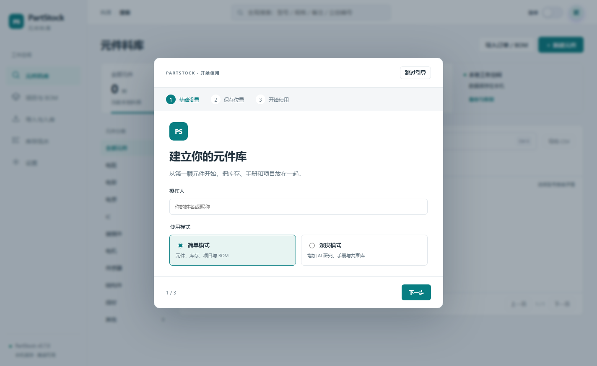
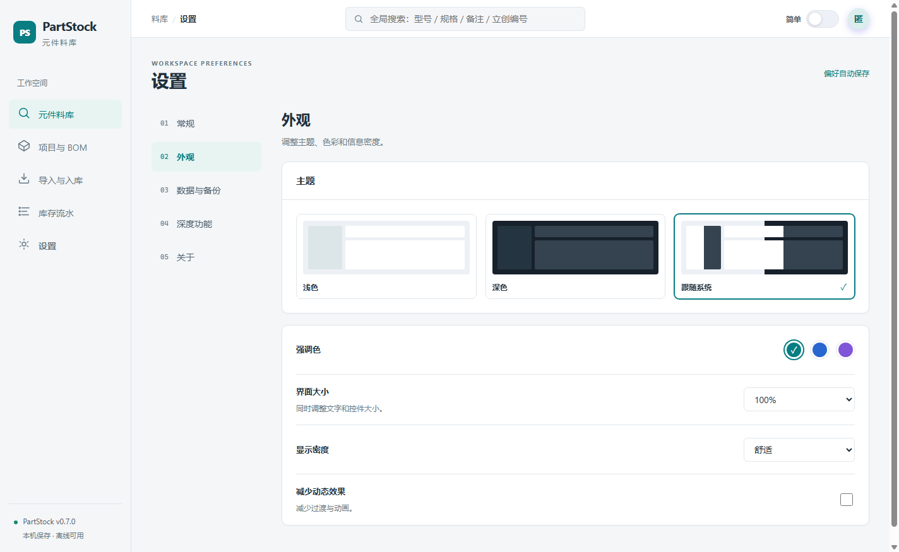

# PartStock · 元件料库

本地离线的电子元件库存 / BOM 匹配 / 成本核算工具，Windows 桌面应用（Electron）。
给电子实验室、电子设计竞赛队伍、小批量硬件团队用：把**散落的元件、货位、批次、项目 BOM、采购成本**放到一处，离线可用，数据只留在本机。

## 下载

到 [Releases](../../releases) 下载最新版：

- `PartStock-v0.7.0-x64-portable.zip` —— 180.5 MB，解压即用，免安装、免 Node.js、不写注册表
- 配套 `SHA256SUMS.txt` 用于校验

## 功能

- **元件料库**：元件 / 批次 / 货位 / 库存量 / 最低库存提醒；按型号、规格、备注、立创编号全局搜索
- **项目与 BOM**：按项目汇总用量、缺口清单、成本核算（含批次单价差异）
- **导入与入库**：Excel / CSV 批量导入立创订单与 BOM、批量位号展开（`R1-R10`）、出库入库
- **库存流水**：每一笔出入库可追溯
- **手册库**：批量导入 PDF 手册，按章节/页查看，自动抽取文本
- **元件研究**（深度模式）：接 OpenAI 兼容接口（DeepSeek / Kimi / 本地模型）+ 可选 Tavily 联网检索，回答带来源
- **共享库**（深度模式）：同网段开库生成邀请码，多机库存实时合并；断网自动降级为离线只读
- **外观**：浅色 / 深色 / 跟随系统、强调色、界面缩放 90–125%、显示密度、减少动效
- **数据目录迁移**：整体搬家，逐文件 SHA256 校验，原目录保留

## 系统要求

- Windows 10 / 11，64 位
- 内存 4 GB 以上，无需独立显卡
- 首次启动会请求防火墙放行（仅"共享库"功能需要，拒绝也不影响单机使用）

## 数据与隐私

- 默认不联网、不上传任何数据
- 库存、操作人、手册路径、API Key 全部保存在本机 `%APPDATA%\PartStock`
- 换盘/备份：设置 → 数据目录 → 迁移，或整体复制该目录

## 关于本仓库

仓库用于**分发发行版**：`Releases` 里是可运行的程序包，`截图/` 是界面截图。
暂未提供可直接构建的工程源码，也未声明开源许可 —— 版权归作者所有。

## 反馈

发现 bug 或有需求，请开 [Issue](../../issues)，附上：版本号、Windows 版本、复现步骤、截图。
